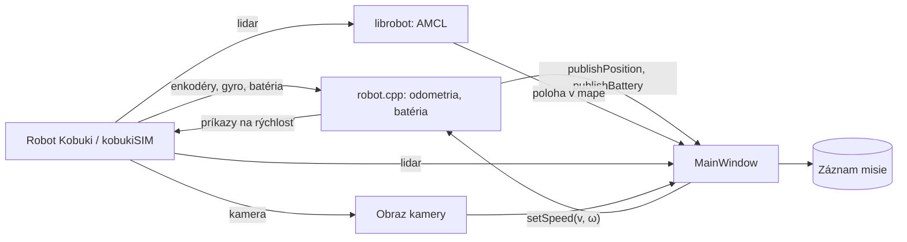
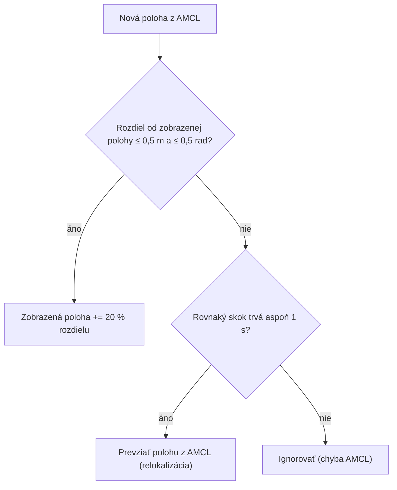
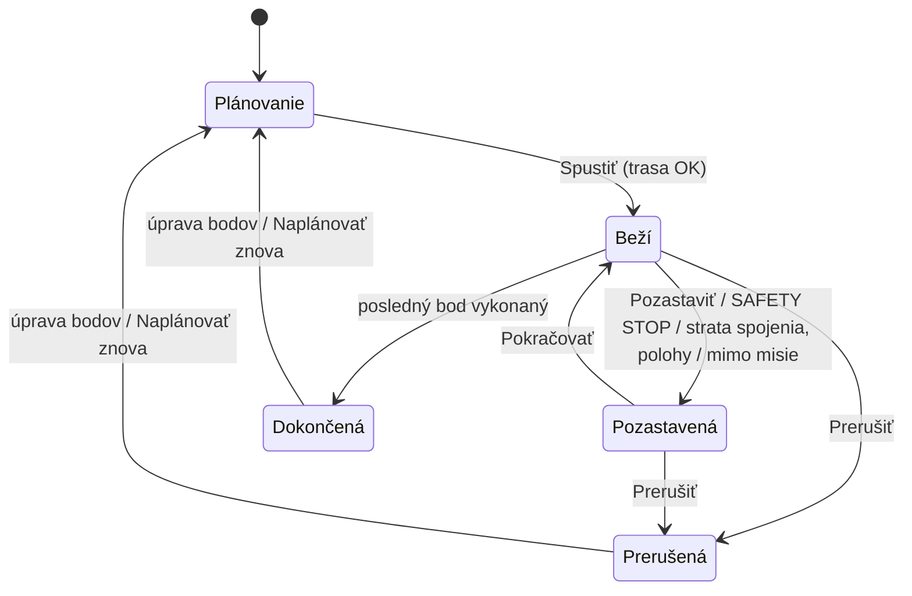

# HMI pre supervízne riadenie robota (Zadanie 2)

Aplikácia v Qt 6 / C++ na plánovanie, vykonanie, záznam a prehrávanie misie robota Kobuki. Operátor zadá
misiu na známej mape, robot ju vykoná autonómne, počas nej hľadá stanovený objekt (červenú loptu)
a celý priebeh sa nahráva. Lokalizáciu zabezpečuje AMCL z knižnice librobot, ktorú HMI kombinuje
s odometriou.

**Obsah**

1. [Spustenie programu](#1-spustenie-programu)
2. [Používateľská príručka](#2-používateľská-príručka)
3. [Popis algoritmov](#3-popis-algoritmov)
4. [Štruktúra zdrojových súborov](#4-štruktúra-zdrojových-súborov)

---

## 1. Spustenie programu

### 1.1 Požiadavky

| Súčasť | Verzia |
|---|---|
| Windows 10/11, kompilátor MSVC 2022 (64-bit) | |
| Qt | 6.9 (MSVC 2022 64-bit), moduly Core, Gui, Widgets, Network |
| CMake | 3.16 alebo novší, generátor Ninja |
| librobot | 1.2.1 s podporou AMCL a OpenCV |
| OpenCV | 4.x (predvolene `C:/OpenCV/opencv-4.14.0/opencv/build`) |
| kobukiSIM (nepovinné) | simulátor na testy bez robota |

### 1.2 Preklad

Projekt sa otvára cez **koreňový `CMakeLists.txt`** (Qt Creator, alebo VS Code s rozšírením CMake Tools).
Z príkazového riadka (v prostredí *x64 Native Tools Command Prompt for VS 2022*):

```bat
cmake -S . -B build -G Ninja -DCMAKE_BUILD_TYPE=Release ^
      -DCMAKE_PREFIX_PATH=C:/Qt/6.9.2/msvc2022_64 ^
      -Dlibrobot_DIR="C:/Program Files/librobot-1.2.1-win64/lib/cmake/librobot" ^
      -DOpenCV_DIR=C:/OpenCV/opencv-4.14.0/opencv/build
cmake --build build
```

Program sa spúšťa ako `build/demoRMR/demoRMR.exe`. Pri spustení musia byť na `PATH` priečinky `bin`
z Qt, librobot a OpenCV.

> Na prácu s robotom používajte konfiguráciu **Release** (alebo RelWithDebInfo). V Debug verzii
> knižníc dáta z robota zaostávajú až o ~1 s za lidarom.

### 1.3 Mapa

- Mapa sa načíta **automaticky pri štarte** zo súboru `mapa.txt` vedľa programu (CMake ho tam
  skopíruje). Ten istý súbor načíta aj lokalizácia AMCL pri pripojení na robot.
- `demoRMR/mapa.txt` je mapa **arény v laboratóriu** (predvolená).
- `demoRMR/mapa_sim.txt` je mapa sveta simulátora kobukiSIM, ktorý sa od arény líši. Na testy v
  simulátore ju skopírujte vedľa programu ako `mapa.txt`.
- Formát: prvý riadok `offsetX offsetY resX resY`, potom riadky mriežky (`1` = stena, `0` = voľno),
  bunka 0,1 m. Riadok 0 je horný okraj mapy.

### 1.4 Pripojenie na robot

1. Do poľa **IP** zadajte adresu robota (pre simulátor `127.0.0.1`) a stlačte **Pripojiť**.
2. Po pripojení **počkajte približne 1 minútu**, kým sa AMCL ustáli na správnom mieste.
3. Skontrolujte, že modré body lidaru ležia na stenách mapy. Až potom spúšťajte misiu.

Záznamy misií sa ukladajú do priečinka `zaznamy` o úroveň vyššie ako priečinok projektu.

---

## 2. Používateľská príručka

### 2.1 Rozloženie okna

```
┌──────────────────────────────────────────────────────────────────────────────┐
│ Robot Control  IP [..........] [Pripojiť] ● stav  [Plánovanie misie][Záznamy] │
│                                                       [Batéria] [Alarmy: N]  │
├────────────────────────────────────────────────────┬─────────────────────────┤
│ pás alarmov (len ak je nejaký alarm aktívny)        │ Kamera                  │
├────────────────────────────────────────────────────┤                         │
│                                                    ├─────────────────────────┤
│                  MAPA (hlavný pohľad)               │ Body misie / Záznamy    │
│                                                    │ Vykonanie misie / Vrstvy│
│                                                    │ Nájdené objekty / Stav  │
├────────────────────────────────────────────────────┤                         │
│ legenda, stav misie │ ovládanie prehrávania  [SAFETY STOP]                  │
└────────────────────────────────────────────────────┴─────────────────────────┘
```

Kliknutím na obraz kamery sa kamera a mapa prehodia (kamera ide do hlavného pohľadu).
**Ctrl+H** skryje spodnú lištu, hlavný pohľad sa tým roztiahne až dolu. SAFETY STOP sa vtedy
presunie do horného panela, aby bol stále dostupný.

### 2.2 Horný panel

| Prvok | Funkcia |
|---|---|
| **IP** | Adresa robota (IPv4, 4 čísla 0–255, inak sa zobrazí upozornenie). Počas pripojenia je pole zamknuté. |
| **Pripojiť / Odpojiť** | Pripojí sa na robot (dáta robota, lidar, kamera, AMCL) alebo sa odpojí. Ak 2 s neprídu dáta, zobrazí sa „Spojenie stratené“. |
| ● stav | Zelená = pripojený, sivá = odpojený. |
| **Plánovanie misie** | Režim editora a vykonania misie (živé dáta). |
| **Záznamy** | Režim prehrávania nahraných misií. Počas misie nie je dostupný. |
| **Batéria** | Stav batérie v %: zelená, oranžová pod 20 %, červená pod 10 %. „–“ = robot napätie neposiela (simulátor). |
| **Alarmy: N** | Počet aktívnych alarmov, červený ak je aspoň jeden. |
| **SAFETY STOP** | Okamžite zastaví robot a zablokuje pohyb. Bežiacu misiu pozastaví. Opätovným stlačením sa uvoľní, misia pokračuje až po stlačení **Pokračovať**. |

### 2.3 Plánovanie misie (editor)

Misia sa skladá z **prejazdových** a **operačných** bodov. Trasa sa kreslí od aktuálnej polohy robota
cez všetky body v poradí (prvý úsek, priblíženie k bodu 1, je prerušovaný).

| Akcia | Ovládanie |
|---|---|
| Pridať bod | Klik ľavým tlačidlom do mapy, v menu vybrať *Operačný bod – úloha* alebo *Prejazdový bod*. Nový bod sa vloží **za označený bod**, inak na koniec misie. |
| Bod do steny | Nie je možné. Klik do steny alebo prekážky (vrátane okraja na šírku robota) ukáže chybové hlásenie. |
| Presunúť bod | Ťahať bod myšou. Ak skončí v kolízii, vráti sa na pôvodné miesto. |
| Zmeniť typ / zmazať | Pravé tlačidlo na bode, alebo stĺpec *Typ / úloha* v tabuľke *Body misie*. |
| Poradie bodov | Tlačidlá **▲ / ▼** pri tabuľke (posunú označený bod). |
| **Zmazať bod** | Zmaže označený bod. |
| **Vymazať misiu** | Zmaže všetky body (s potvrdením). |

**Kontrola trasy** (panel *Vykonanie misie*). Misiu nie je možné spustiť, ak:

- misia nemá aspoň jeden operačný bod,
- niektorý bod leží v prekážke,
- niektorý úsek trasy (vrátane úseku od robota k bodu 1) prechádza prekážkou. Úsek sa vyznačí
  červenou prerušovanou čiarou s krížikom.
- batéria je pod 10 %, robot nie je pripojený, je aktívny SAFETY STOP, poloha robota nie je známa,
  alebo je robot mimo misie.

### 2.4 Vykonanie misie

| Tlačidlo | Funkcia |
|---|---|
| **Spustiť** | Skontroluje trasu, spustí misiu a nahrávanie. Po skončení misie sa volá **Naplánovať znova**: zobrazí a skontroluje trasu od aktuálnej polohy robota, ďalšie stlačenie misiu spustí od bodu 1. |
| **Pozastaviť** | Robot zastaví, misia čaká. |
| **Pokračovať** | Obnoví pozastavenú misiu (aj po SAFETY STOP alebo automatickom pozastavení). |
| **Prerušiť** | Ukončí misiu (s potvrdením), čiastočný záznam zostane uložený. |

Misia sa **pozastaví automaticky**, ak sa stratí spojenie, aktivuje sa SAFETY STOP, poloha nie je
známa alebo je robot mimo misie. Počas misie nie je možné body upravovať. Stav misie (BEŽÍ, STOJÍ,
POZASTAVENÉ, DOKONČENÉ…) a aktuálnu činnosť ukazuje spodná lišta.

### 2.5 Úlohy v operačných bodoch

| Úloha | Čo robot vykoná |
|---|---|
| Odfotiť okolie | Zastaví a uloží fotografiu z kamery (`foto/bod_NN.jpg`), trvá 1,5 s. |
| Počkať 3 s | Stojí 3 s. |
| Otočiť sa o 360° | Otočí sa na mieste o celý kruh (meraný odometriou). |
| Hľadať objekt (sken 360°) | Otočí sa o celý kruh, aby kamera prezrela okolie. Detekcia objektu beží počas celej misie. |

### 2.6 Alarmy

Aktívne alarmy sa zobrazujú v páse nad mapou (červené = nebezpečenstvo, oranžové = varovanie),
dôležité udalosti aj krátkym hlásením na spodku mapy.

| Alarm | Kedy |
|---|---|
| SPOJENIE | Robot nie je pripojený alebo 2 s neposlal dáta. |
| SAFETY STOP | Pohyb je zablokovaný operátorom. |
| BATÉRIA | Pod 20 % varovanie, pod 10 % kritický stav (spustenie misie zablokované). |
| PREKÁŽKA V MISII | Lidar vidí prekážku pred robotom na trase. Robot zastaví a pokračuje po jej odstránení. |
| ROBOT MIMO MISIE | Sken lidaru nesedí s mapou (zmena prostredia alebo strata lokalizácie). Misia sa pozastaví. |

### 2.7 Nájdené objekty

Keď robot počas misie nájde červenú loptu, zobrazí sa hlásenie, na mape fialový kosoštvorec
s názvom a istotou detekcie a v zozname *Nájdené objekty* náhľad fotografie s polohou a časom.
Fotografia s vyznačeným objektom sa uloží do záznamu misie. V obraze kamery sa nájdený objekt
orámuje.

### 2.8 Záznamy a prehrávanie

Každá misia sa nahráva automaticky do priečinka `zaznamy/misia_RRRR-MM-DD_HH-MM-SS`.

| Prvok | Funkcia |
|---|---|
| Zoznam záznamov | Výber záznamu ho načíta na prehrávanie. |
| **Obnoviť** / **Vymazať záznam** | Obnoví zoznam / zmaže vybraný záznam (s potvrdením). |
| **\|◀◀**, **−5 s**, **Prehrať/Pauza**, **+5 s** | Ovládanie prehrávania. |
| Časová os | Posun v čase. Značky na osi sú operačné body (modré) a nájdené objekty (fialové). |
| Rýchlosť | 0,5×, 1×, 2×, 4×. |
| Vrstvy | *Poloha AMCL*, *Odometria*, *Lidar*, *Kamera* sa dajú zapnúť a vypnúť. |
| Stav v čase | Poloha z AMCL, odometria, poloha voči štartu misie, odchýlka odometrie od AMCL, posledná udalosť. |

Na mape sa počas prehrávania kreslí robot tak, ako bol zobrazený počas misie, jeho dráha (zelená),
odometria (oranžová prerušovaná dráha a obrys robota), surové dáta AMCL (tenká modrá čiara,
krátkodobé chybné polohy AMCL sú označené červeným krížikom), sken lidaru a obraz kamery v danom čase.
Nápis *PREHRÁVANIE ZÁZNAMU* upozorňuje, že nejde o živé dáta.

**Súbory záznamu** (čas `t_ms` = milisekundy od štartu misie, spoločný pre všetky súbory):

| Súbor | Obsah |
|---|---|
| `mission.json` | Body misie, mapa, čas štartu. |
| `poses.csv` | Každých 100 ms: poloha z AMCL (`amcl_*`), odometria v súradniciach mapy (`odom_*`), poloha zobrazená počas misie (`view_*`), poloha voči počiatočnému súradnicovému systému (`start_*`, robot na štarte misie = 0, 0, 0°, x dopredu, y doľava). |
| `scan.csv` | Každý sken lidaru: dvojice uhol [°], vzdialenosť [mm]. |
| `camera.csv`, `camera/*.jpg` | Snímky kamery každých 200 ms. |
| `events.csv` | Udalosti: operačné úlohy, alarmy, detekcie, koniec misie. |
| `detections.csv`, `detekcie/*.jpg` | Nájdené objekty: čas, istota, poloha x, y, fotografia a rámček v obraze. |
| `foto/*.jpg` | Fotografie z úlohy *Odfotiť okolie*. |

### 2.9 Klávesové skratky

| Skratka | Funkcia |
|---|---|
| **Ctrl+H** | Skryje alebo zobrazí spodnú lištu (SAFETY STOP sa presunie do horného panela). |

---

## 3. Popis algoritmov

### 3.1 Tok dát



Backend (`robot.cpp`) spracúva dáta z robota a posiela ich do okna cez signály Qt. Okno
(`mainwindow.cpp`) z nich počíta polohu na mape, riadi misiu a posiela robotu príkazy na rýchlosť.

### 3.2 Odometria (`robot::updateOdometry`)

Z každého paketu robota (~50 Hz) sa počíta prírastok dráhy z enkodérov a uhla z gyroskopu.

```
ΔL = (int16)(encL − encL_prev) · 0,0852921 mm        // rozdiel v 16 bitoch => pretečenie enkodéra nevadí
ΔR = (int16)(encR − encR_prev) · 0,0852921 mm
Δs = (ΔL + ΔR) / 2
Δg = gyro − gyro_prev                                 // gyro v stotinách stupňa, rozsah −18000 … 18000
if Δg >  18000: Δg −= 36000                           // prechod cez ±180°
if Δg < −18000: Δg += 36000
Δθ = gyro platné ? Δg / 100 · π/180  :  (ΔR − ΔL) / 0,230 m
x += Δs · cos(θ + Δθ/2)                               // integrácia so stredovým uhlom (oblúk)
y += Δs · sin(θ + Δθ/2)
θ  = normalizuj(θ + Δθ)
```

Gyroskop sa považuje za platný, keď sa jeho hodnota aspoň raz zmení. Dovtedy sa uhol počíta z rozdielu
kolies. Výsledná poloha (x, y, θ) sa posiela do okna s každým paketom.

**Zarovnanie s mapou:** odometria je v súradniciach, kde robot stál pri pripojení. Pri štarte misie
sa uloží odometria aj poloha z AMCL v tom okamihu (kotva). Každá ďalšia poloha odometrie sa prevedie
do mapy tuhou transformáciou, ktorá zobrazí kotvu odometrie na kotvu AMCL. Ten istý pohyb vyjadrený
v súradniciach robota na štarte misie je poloha voči počiatočnému súradnicovému systému (`start_*`).

### 3.3 Batéria (`robot::updateBattery`)

Robot posiela napätie v desatinách voltu. Prepočet na percentá: `% = (U − 13,2 V) / (16,7 V − 13,2 V) · 100`,
obmedzené na 0–100 %. Hodnota 0 V (simulátor) sa ignoruje. Do okna sa posiela len zmena.

### 3.4 Príkaz na pohyb (`robot::setSpeed`)

Okno posiela doprednú rýchlosť v [mm/s] a rotáciu ω [rad/s]. Robot Kobuki jazdí po oblúku s polomerom
R = v / ω, ktorý berie ako 16-bitové číslo:

```
if v = 0 and ω = 0:      zastav
else if v = 0 or |R| < 10 mm:   otáčanie na mieste rýchlosťou ω
else if ω = 0 or |R| > 30 m:    priamy pohyb rýchlosťou v
else:                           oblúk (v, R)
```

Reálny robot sám zastaví, ak ~3 s nedostane nový príkaz. Nezmenený príkaz sa preto posiela znova
každých 500 ms (`MainWindow::sendSpeed`).

### 3.5 Lokalizácia: AMCL a odometria (`setRobotPose`, `handleOdometry`)

AMCL (librobot, 1500 častíc) porovnáva sken lidaru s mapou a posiela polohu v mape v [mm] (os y
nahor, rovnako ako mapa). Poloha z AMCL prichádza ~7× za sekundu a kmitá o niekoľko centimetrov
a stupňov. Občas na 0,1–0,2 s ukáže polohu metre vedľa a otočenú o 90–180°.
Poloha, ktorou sa robot kreslí aj riadi, preto vzniká takto:

```
pri každej odometrii:  posuň zobrazenú polohu o pohyb odometrie od minulého paketu

pri každej polohe z AMCL (a):
    e = a − zobrazená
    if |e| ≤ 0,5 m and |e_θ| ≤ 0,5 rad:          // bežná korekcia
        zobrazená += 0,2 · e                     // 20 % rozdielu => vyhladenie kmitania AMCL
    else:                                        // veľký skok
        if skok s rovnakým posunom (±0,3 m, ±0,3 rad) trvá ≥ 1 s:
            zobrazená = a                        // skutočná relokalizácia
        else:
            ignoruj                              // krátkodobá chyba AMCL
```

Robot sa na obrazovke vykresľuje 60× za sekundu a za vypočítanou polohou plynulo dobieha s časovou
konštantou 0,1 s.



### 3.6 Kontrola kolízií trasy (`isBlocked`, `segmentBlocked`)

- Mapa sa pri načítaní **nafúkne** o polomer robota a rezervu (0,177 m + 0,05 m, t. j. 3 bunky):
  bunka je zakázaná, ak je v tejto vzdialenosti od steny.
- Bod je v kolízii, ak leží v zakázanej bunke alebo mimo mapy.
- Úsek A → B je v kolízii, ak je zakázaný niektorý z bodov úseku vzorkovaných každých 5 cm.
- Trasa sa kontroluje od aktuálnej polohy robota (AMCL) cez všetky body misie. Trasa sa spája priamo,
  kolízny úsek sa vyznačí a misiu nie je možné spustiť.

### 3.7 Riadenie misie (stavový automat, `missionTick` každých 100 ms)



```
každých 100 ms, ak misia beží:
    ak je prekážka na spustenie (spojenie, SAFETY STOP, poloha, mimo misie): pozastav misiu
    bod = body[i]
    ak robot nevykonáva úlohu:
        ak vzdialenosť k bodu < 0,15 m:
            zastav
            operačný bod ? začni úlohu : i += 1 (ďalší bod)
        inak: regulátor jazdy na bod (3.8)
    inak (úloha):
        otočiť / hľadať:  otáčaj 0,8 rad/s, sčítaj otočenie z odometrie
        koniec úlohy:     foto 1,5 s | čakať 3 s | otočenie |Σ Δθ| ≥ 360° (poistka 3× očakávaný čas)
        po úlohe: i += 1
    ak i = počet bodov: misia dokončená, záznam uložený
```

### 3.8 Regulátor jazdy na bod (`driveToGoal`, združený regulátor)

Dopredná aj rotačná rýchlosť sa regulujú súčasne, robot ide k bodu po oblúku.

```
d   = vzdialenosť k bodu,  err = normalizuj(atan2(Δy, Δx) − θ)
ω   = obmedz(1,5 · err, ±0,7 rad/s)                       // P regulátor natočenia
if prekážka pred robotom:
    v = 0;  ω = |err| > 10° ? ω : 0                        // len otáčanie na mieste k bodu
else:
    v = |err| < 60° ? obmedz(600 · d, 80, 300) · cos(err) : 0   // [mm/s], pri veľkej chybe najprv otočenie
    v = min(v, v_predchádzajúce + 300 mm/s² · 0,1 s)       // rampa zrýchlenia
pošli (v, ω)
```

Regulátor používa zobrazenú polohu z 3.5 (odometria opravovaná AMCL), nie surovú polohu z AMCL, ktorá kmitá.

### 3.9 Prekážka na trase a robot mimo misie (`handleScan`)

- **Prekážka:** z každého skenu lidaru sa hľadá bod v koridore pred robotom: 0 < x < 450 mm
  a |y| < 0,177 m + 40 mm (šírka robota s rezervou). Ak taký bod je, robot nejde dopredu a zobrazí
  sa alarm. Po uvoľnení koridoru pokračuje.
- **Robot mimo misie:** body skenu do 6 m sa premietnu do mapy podľa polohy z AMCL. Zhoda je podiel
  bodov, ktoré padnú do 0,2 m od steny mapy. Ak je zhoda pod 50 % dlhšie ako 2 s, robot je mimo misie
  (zmena prostredia alebo strata lokalizácie): alarm a pozastavenie misie.

### 3.10 Záznam a prehrávanie (`recordTick`, `showReplayFrame`)

- Všetky súbory záznamu majú spoločný čas `t_ms` od štartu misie, preto sú dáta **synchronizované v čase**.
  Polohy sa zapisujú každých 100 ms, sken lidaru pri každom príchode, snímky kamery každých 200 ms.
- Pri prehrávaní sa poloha v čase t **interpoluje** medzi dvoma susednými vzorkami (uhol cez
  najkratší rozdiel). Zobrazí sa posledný sken a snímka kamery pred časom t. Sken sa kreslí v polohe
  robota z času, keď bol nameraný.
- Vzorky AMCL vzdialené od zobrazenej polohy viac ako 0,5 m alebo 0,5 rad sa v dráhe AMCL nespájajú
  a označia sa červeným krížikom (krátkodobá chyba AMCL).

### 3.11 Vyhľadávanie objektu (`detectTarget`, `handleDetection`)

Počas misie sa kontroluje každý tretí snímok z kamery.

**Rozpoznanie v obraze** (OpenCV, segmentácia podľa farby):

```
hsv  = RGB → HSV
mask = (H ∈ ⟨0, 10⟩ ∪ ⟨170, 180⟩) and S ≥ 90 and V ≥ 35      // tmavočervená lopta v laboratóriu
mask = morfologické otvorenie (elipsa 5×5)                    // odstránenie šumu
obrys = najväčší obrys v maske
odmietni, ak plocha < 0,2 % obrazu
odmietni, ak okrúhlosť 4π·plocha/obvod² < 0,5                // kruh = 1
odmietni, ak plocha / plocha opísanej kružnice < 0,45        // napr. pás pásky na podlahe
istota = 0,5 + 0,5 · okrúhlosť
```

Prahy boli nastavené podľa snímok z kamery reálneho robota (lopta má jas len ~50–120, sivé steny
a podlaha majú sýtosť pod 25). Pri bežnej veľkosti lopty je dosah detekcie približne 20-násobok
jej priemeru, najviac 6 m.

**Poloha objektu na mape:**

```
smer   = (0,5 − x_stredu_v_obraze) · 60°                     // zorný uhol kamery 60°, doľava kladný
d      = najmenšia vzdialenosť lidaru v smere (±3°), musí byť ≤ 6 m
x_obj  = x_robota + d · cos(θ_robota + smer)                  // poloha robota z AMCL
y_obj  = y_robota + d · sin(θ_robota + smer)
ak je do 0,7 m už známy objekt: ten istý objekt, nezapisuje sa znova
inak: fotografia s rámčekom, záznam do detections.csv, značka v mape, zoznam a hlásenie operátorovi
```

---

## 4. Štruktúra zdrojových súborov

| Súbor | Obsah |
|---|---|
| `CMakeLists.txt` | Koreňový projekt (Qt 6, OpenCV, librobot). |
| `demoRMR/robot.cpp`, `robot.h` | Backend: komunikácia s robotom cez librobot, odometria, batéria, príkazy na pohyb, AMCL. |
| `demoRMR/mainwindow.cpp`, `mainwindow.h`, `mainwindow.ui` | Používateľské rozhranie: mapa a editor misie, lokalizácia na mape, riadenie misie, alarmy, záznam a prehrávanie, detekcia objektu. |
| `demoRMR/mapa.txt` | Mapa arény (načíta ju HMI aj AMCL). |
| `demoRMR/mapa_sim.txt` | Mapa sveta simulátora kobukiSIM. |
